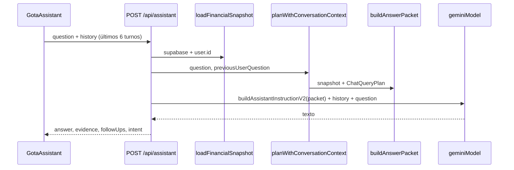

# G05-A — Auditoría del asesor / inteligencia existente (solo lectura)

**Fecha:** 2026-10-24  
**Alcance:** código en `main` al momento del PR; sin llamadas a APIs de IA ni datos de producción.  
**Fuera de alcance:** SmartInput (`/api/parse-expense`) — es captura con Gemini, no consulta financiera. Este informe se centra en **Gota Asistente** (chat) y la **capa de inteligencia determinística** que lo alimenta (snapshot, planner, evidencia, héroes).

---

## 1. Resumen ejecutivo

La app tiene **dos superficies de “inteligencia”** relacionadas pero distintas:

| Superficie | Naturaleza | ¿LLM? |
|---|---|---|
| **Gota Asistente** (FAB + panel) | Chat de solo lectura sobre datos del usuario | Sí — redacción final |
| **Héroes / señales** (Análisis, chips) | Reglas + snapshot | No |
| **Home ambiental** (flags aparte) | Orquestador determinístico en dashboard | No |

El asesor **no calcula cifras en el modelo**. El flujo es: cargar snapshot por `user_id` → planificar intent (`chat-planner`) → armar `AnswerPacket` (`chat-evidence`) → instruir a Gemini con hechos cerrados (`chat-prompt`) → el modelo solo redacta.

**Riesgo principal:** la paridad con el motor de Análisis está bien cubierta en **hechos precalculados** (serie mensual, same-day, categorías), pero **no** en preguntas por **medio de pago**, **rangos de fecha arbitrarios** o **totales por ventana** sin hecho agregado explícito. Además, el **LLM puede desviarse** del packet (no hay test de texto generado en CI).

**Visibilidad hoy:** el asistente solo se monta si `FF_GOTA_ASSISTANT` **y** `canUsePaidAI(user)` (allowlist + usuario no anónimo + `GOTA_PAID_AI_ENABLED`).

---

## 2. Entrada visible del asesor

| Ubicación | Archivo | Comportamiento |
|---|---|---|
| FAB flotante | `components/assistant/GotaAssistant.tsx` | Botón fijo; abre diálogo “Gota Asistente” / “Basado en tus datos reales”. |
| Montaje condicional | `app/(dashboard)/layout.tsx` | `{FF_GOTA_ASSISTANT && canUsePaidAI(user) && <GotaAssistant />}`. |
| API | `POST /api/assistant` | `app/api/assistant/route.ts` — 404 si flag off; 401 sin sesión; 403 si no `canUsePaidAI`. |
| Apertura con pregunta | `lib/assistant/events.ts` + `GotaAssistant` | Evento `ASSISTANT_OPEN_EVENT`; usado desde héroes (`IntelligenceHero.tsx`). |
| Sugerencias iniciales | `GotaAssistant.tsx` (`SUGGESTIONS`) + `/api/intelligence/heroes` | Chips estáticos + hasta 3 preguntas de CTAs de héroes si `FF_INTELLIGENCE`. |

**Flags:** `lib/flags.ts` — `FF_GOTA_ASSISTANT` (env `FF_GOTA_ASSISTANT` o `NEXT_PUBLIC_FF_GOTA_ASSISTANT`). Inteligencia de héroes: `FF_INTELLIGENCE` (activa por defecto).

**Política de acceso IA paga:** `lib/paid-ai-policy.ts` — `canUsePaidAI`, `PAID_AI_UNAVAILABLE`. Tests: `lib/paid-ai-routes.test.ts`.

---

## 3. Pipeline del asesor (herramientas y funciones)



| Paso | Módulo | Funciones clave |
|---|---|---|
| Historial | `lib/assistant/prompt.ts` | `normalizeAssistantHistory` |
| Contexto multi-turno | `lib/intelligence/chat-context.ts` | `planWithConversationContext`, `extractSlots` — follow-ups “¿y el mes pasado?” / “¿y en 6 cuotas?” sin LLM |
| Intención y plan | `lib/intelligence/chat-planner.ts` | `detectIntent`, `planChatQuery`, `extractSearchTerms`, `extractSimulation` |
| Datos | `lib/intelligence/snapshot.ts` | `loadFinancialSnapshot`, `assembleFinancialSnapshot`, `fetchExpenseRows` |
| Hechos y movimientos | `lib/intelligence/chat-evidence.ts` | `buildAnswerPacket`, `selectMovements`, `selectAnswerEvidenceIds` |
| Proyección / ritmo | `lib/intelligence/projection.ts` | `computeSafeToSpend`, `simulatePurchase`, `computeInstallmentHorizon` |
| Features analíticas | `lib/intelligence/features.ts` | `computeSameDaySpend`, `computeBudgetPace`, `computeWantsShare`, … |
| Señales | `lib/intelligence/insight-rules.ts` | `buildInsightCandidates` (intent `what_should_i_do`) |
| Prompt LLM | `lib/intelligence/chat-prompt.ts` | `buildAssistantInstructionV2` — reglas fail-closed en texto |
| Modelo | `lib/gemini/client.ts` | `gemini-2.5-flash-lite`, `temperature: 0.2`, `maxOutputTokens: 500` en ruta assistant |
| Rate limit | `lib/rate-limit` | 8 req/min por usuario en assistant |

**Intents soportados** (`ChatIntent` en `chat-planner.ts`):  
`balance_status`, `movement_lookup`, `category_breakdown`, `category_history`, `trend_comparison`, `budget_question`, `card_commitments`, `subscription_question`, `yield_question`, `goal_question`, `affordability`, `wants_question`, `installment_question`, `what_should_i_do`, `general`.

---

## 4. Datos a los que accede el snapshot

`loadFinancialSnapshot` (`snapshot.ts`) para un `userId` autenticado:

| Fuente | Query / función | Campos relevantes | Límite |
|---|---|---|---|
| Dashboard | `readDashboardData` | Saldo Vivo, Disponible Real, cuentas, tarjetas, suscripciones, metas, ingresos recurrentes | Reutiliza motor dashboard |
| Presupuesto | `getBudgetSnapshot` | Plan y avance por categoría | Mes seleccionado |
| Gastos | `expenses` | amount, currency, category, description, `payment_method`, cuotas, `is_want`, `is_extraordinary` | **2000** filas / ventana ~6 meses |
| Ingresos | `income_entries` | id, amount, currency, category, date | **200** |
| Transferencias | `transfers` | montos y monedas | **200** |
| Cuotas futuras | `expenses` (solo installments) | hasta ~6 meses adelante | 400 filas |
| Moneda | `user_config.default_currency` o dashboard | ARS / USD | Una moneda “principal” por snapshot |
| Histórico mínimo | gasto más antiguo | `earliestDataMonth` | 1 fila |

**Ventana temporal del snapshot:** desde `addMonths(month, -5)` hasta fin del mes en curso (más proyección de cuotas). Gastos fuera de ventana se descartan en `assembleFinancialSnapshot`.

**Agregados derivados (motor compartido con Análisis):**

- Serie mensual: `buildMonthlySeries` (`lib/analytics/monthly-series.ts`) con `isPerceivedExpense`, `isCreditAccruedExpense`, `isApplicableCardPayment` (`lib/movement-classification.ts`) — mismo criterio que Análisis (comentario en `snapshot.ts` L318-321).
- Agregados por mes/categoría: `buildMonthAggregates` — incluye `habitualAmount` (excluye extraordinarios).
- Movimientos normalizados: `buildMovements` — incluye `paymentMethod` por gasto, pero **no** hay rollup por medio en el chat.

**Cobertura / truncamiento:** `snapshot.coverage.*.truncated` si se alcanza el límite de filas. El **home orchestrator** reacciona (`home-orchestrator.ts` `isTruncated`); el **packet del asesor no añade un caveat explícito de truncamiento** (brecha).

---

## 5. Proveedor y modelo de IA

| Uso | Ruta | Modelo | Rol |
|---|---|---|---|
| Asistente | `app/api/assistant/route.ts` | `gemini-2.5-flash-lite` (`lib/gemini/client.ts`) | Parafrasear hechos del `AnswerPacket`; prohibido inventar números en prompt |
| SmartInput (no asesor) | `app/api/parse-expense/route.ts` | Mismo cliente | Extracción estructurada de gastos |

El asistente envía un turno sintético del modelo (“Entendido. Voy a responder solo con esos datos.”) más historial (roles user/model) y la pregunta actual.

---

## 6. Capacidades reales (qué puede responder hoy)

Basado en intents, secciones del packet y tests en `lib/intelligence/__tests__/`.

| Área | Capacidad | Evidencia en código / tests |
|---|---|---|
| Saldos y disponible | Saldo Vivo, Disponible Real, por cuenta, libre tras metas | `chat-evidence.test.ts` balance_status |
| Ritmo / “¿cuánto por día?” | `computeSafeToSpend` | affordability, balance_status tests |
| Simulación compra / cuotas | `simulatePurchase`, veredicto determinístico | affordability tests |
| Presupuesto | Avance por categoría; caveat si no hay plan | budget_question tests |
| Tarjetas y vencimientos | Resúmenes, ciclo en curso | card_commitments tests |
| Suscripciones | Listado y total aproximado | `buildSubscriptionsFacts` |
| Categorías (mes actual / anterior) | Top categorías con etiquetas de alcance temporal | category_breakdown tests |
| Historial por categoría | Promedio, rango, meses usados; sin inflar con extraordinarios | category_history tests |
| Tendencia / “a esta altura” | `computeSameDaySpend` + serie (últimos 4 meses en hechos) | trend_comparison tests, `features.test.ts` |
| Movimientos | Filtro por ventana, términos, grandes, deseos | movement_lookup tests |
| Deseos | Share y movimientos `is_want` | wants_question tests |
| Cuotas futuras | Horizonte 6 meses | installment_question tests |
| Metas | Detalle por meta | goal_question tests |
| “¿Qué mirar hoy?” | `buildInsightCandidates` | what_should_i_do tests |
| Crear/editar movimientos | Solo lectura — instrucción en prompt | `chat-prompt.ts` |

**Relacionado (no es el chat):**

- `GET /api/intelligence/heroes` → `buildHeroesResponse` (`heroes.ts`) — copy determinístico.
- `GET /api/intelligence/signals` — centro de señales (flag `FF_SIGNALS_CENTER_V1`).
- Home: `lib/server/load-home-intelligence.ts` → `buildHomeIntelligence` (`home-orchestrator.ts`) con flags ambientales.

---

## 7. Aislamiento por usuario

| Capa | Mecanismo |
|---|---|
| API | `createClient()` + `supabase.auth.getUser()`; sin usuario → 401 |
| Datos | Todas las queries en `loadFinancialSnapshot` usan `.eq('user_id', userId)` (gastos, ingresos, transferencias, config) |
| Dashboard | `readDashboardData({ userId })` — mismo patrón que el resto de la app |
| Rate limit | Clave `assistant:${user.id}` |
| IA paga | Allowlist `GOTA_PAID_AI_USER_IDS`; anónimos excluidos (`paid-ai-policy.ts`, tests en `paid-ai-routes.test.ts`) |

No hay parámetro de `userId` en el body del cliente; el servidor deriva identidad solo de la sesión.

---

## 8. Falta de datos, errores y fail-closed

### Capa determinística (packet)

| Situación | Comportamiento | ¿Se convierte en cero? |
|---|---|---|
| Sin presupuesto activo | `caveats.push('No hay presupuesto activo...')`; no facts de presupuesto | No — no afirma 0% ni $0 de presupuesto |
| Sin histórico comparativo | Caveat primer mes / `computeSameDaySpend` → `dataQuality: 'insufficient'` | No — omite referencia, no inventa baseline 0 |
| Categoría sin histórico | Caveat “No encontré histórico…” | No |
| Sin movimientos que coincidan | Caveat “No encontré movimientos…” | No — lista vacía, no total $0 implícito en facts |
| Sin ingreso de referencia (cuotas) | Caveat explícito | No |
| Sin rendimientos | Caveat; facts vacíos en yield | No |
| Sin señales | Fact “Sin señales de riesgo…” | No es un monto |
| Simulación sin monto | Caveat; usa margen general | No inventa monto 0 |
| Referencia same-day con baseline | `Math.round(sameDay.baselineAmount ?? 0)` en label de fact — **si hubiera baseline null mezclado con lógica else, el código usa 0 solo al formatear referencia cuando ya pasó el guard de insufficient** | Parcial — ver `buildTrendFacts`; con `insufficient` no se emiten facts de referencia |

Tests que fijan fail-closed: `chat-evidence.test.ts` (presupuesto, histórico, movimientos vacíos, categoría inexistente).

### Capa HTTP / UI

| Situación | Comportamiento |
|---|---|
| Error 500 en API | JSON `{ error: 'No pude consultar...' }`; UI muestra error (`GotaAssistant.tsx`) |
| Respuesta vacía del modelo | Fallback string “No pude armar una respuesta…” (`route.ts` L104-106) |
| 403 paid AI | Mensaje `PAID_AI_UNAVAILABLE` |

### Capa LLM (riesgo residual)

El prompt prohíbe inventar números, pero **no hay aserción automatizada** sobre el texto final del modelo. La paridad “respuesta == motor” **no es verificable en CI** hoy sin golden tests o modo sin LLM.

---

## 9. Matriz — primer corte de preguntas

Criterios de estado:

- **responde igual al motor:** el número expuesto al LLM sale de las mismas funciones/reglas que Análisis (o dashboard), con tests unitarios que lo fijan.
- **no responde:** no hay intent, sección ni hecho agregado; el packet no puede sostener la respuesta sin aritmética nueva del LLM.
- **no verificable:** haría falta comparar contra producción o contra la redacción del LLM.

| Pregunta tipo | Ejemplo | Estado | Justificación |
|---|---|---|---|
| **Gasto por período** | “¿Cuánto llevo gastado este mes?” (total en moneda base) | **responde igual al motor** | El mes en curso aparece en `monthlySeries` vía `buildMonthlySeries` (`snapshot.ts` L318-331) y en hechos de tendencia como `percibidoDevengadoTotal` (`chat-evidence.ts` `buildTrendFacts`). Misma clasificación de movimientos que Análisis (`movement-classification`). Test indirecto: `features.test.ts` “cuota devengada… suma al mes” (`percibidoDevengadoTotal` 190_000). |
| **Gasto por período** | “¿Cuánto gasté ayer / esta semana / el mes pasado?” (total agregado) | **no responde** | `movement_lookup` con ventanas (`resolveWindow` en `chat-evidence.ts` L846-868) entrega **lista** de movimientos (`selectMovements`), no un hecho “total del período”. El prompt prohíbe “contabilidad nueva” (`chat-prompt.ts` L61). Sin fact agregado por ventana. Planner: `chat-planner.test.ts` ventanas temporales. |
| **Gasto por período** | “¿Cuánto gasté del 16 al 31 de agosto?” | **no responde** | No hay parser de rango arbitrario en `chat-planner.ts` ni facts por subperíodo. Relacionado con caso G05-C (aceptación heredada), aún no implementado en planner. |
| **Por categoría** | “¿En qué estoy gastando más este mes?” / promedio en supermercado | **responde igual al motor** | `buildCategoriesFacts` y `buildCategoryHistoryFacts` usan `monthAggregates` (`habitualAmount` excluye extraordinarios). Tests: `chat-evidence.test.ts` describe `category_breakdown` y `category_history` (incl. extraordinarios). |
| **Por medio de pago** | “¿Cuánto gasté con tarjeta vs débito este mes?” | **no responde** | `payment_method` está en movimientos (`snapshot.ts` `buildMovements`) pero **no** hay intent ni `build*Facts` que agregue por medio. Único uso en chat: etiqueta de suscripciones (`chat-evidence.ts` L325). `computeMetrics.ts` en Análisis filtra por `CREDIT` para métricas — **no reutilizado** en asesor. |
| **Cambio entre períodos** | “¿Qué cambió vs meses anteriores a esta altura?” | **responde igual al motor** | `computeSameDaySpend` (`features.ts`) sobre `monthlySeries` — misma regla que overview de Análisis. Tests: `chat-evidence.test.ts` `trend_comparison`; sin histórico → caveat, no referencia ficticia. |
| **Cambio entre períodos** | Comparar dos meses cerrados arbitrarios (ej. ago 16–31 vs sep 16–30) | **no verificable** / **no responde** | No hay facts para subrangos ni comparación binaria custom; G05-C describe el caso de aceptación pero no hay código que lo implemente. Sin datos de producción no se puede validar paridad end-to-end. |
| **Redacción final al usuario** | Cualquiera de las anteriores | **no verificable** | CI cubre `buildAnswerPacket`, no `geminiModel.generateContent`. Riesgo de desvío del prompt pese a hechos correctos. |

---

## 10. Propuesta de ítems de implementación (para Ideas)

G05-B y G05-C ya cubren paridad general y el caso heredado ago/sep. Ítems **nuevos** sugeridos:

| ID | Título | Por qué (1 línea) | Criterio de listo (testeable) |
|---|---|---|---|
| **G05-D** | Asesor: gasto y comparación por medio de pago | El snapshot trae `payment_method` pero el packet no agrega ni detecta preguntas por medio. | Intent + facts con mismos criterios que `computeMetrics` / resumen; tests de packet con mezcla CASH/DEBIT/CREDIT; caveat si moneda mixta. |
| **G05-E** | Asesor: totales por ventana temporal (día, semana, mes pasado) | Hoy solo hay listas de movimientos; el LLM no debe sumar. | Hecho agregado por ventana alineado a `monthAggregates` o serie mensual; tests `buildAnswerPacket` por cada `MovementWindowKind`. |
| **G05-F** | Asesor: caveat de cobertura truncada en el packet | Límites 2000/200/200 pueden sesgar totales sin aviso en chat (sí en home/signal-center). | Si `snapshot.coverage.*.truncated`, caveat obligatorio en `buildAnswerPacket`; test con fixture truncado. |
| **G05-G** | Modo verificable del asesor (packet → respuesta sin LLM en tests) | Paridad motor no se puede certificar mientras solo se testea el packet. | Flag de test o contrato que compare texto mínimo / plantilla contra facts; o snapshot golden del instruction sin llamar a Gemini en CI. |

**Refino opcional de G05-B (sin cambiar espíritu):** explicitar en criterio de listo los cuatro ejes del primer corte (período, categoría, medio, cambio) y el modo “sin LLM” para regresiones numéricas.

---

## 11. Referencia rápida de archivos

```
components/assistant/GotaAssistant.tsx      # UI chat
app/api/assistant/route.ts                    # Orquestación API + Gemini
lib/intelligence/chat-planner.ts              # Intents y plan
lib/intelligence/chat-context.ts              # Follow-ups determinísticos
lib/intelligence/chat-evidence.ts             # AnswerPacket
lib/intelligence/chat-prompt.ts               # Instrucción al modelo
lib/intelligence/snapshot.ts                  # Carga y ensamblado
lib/intelligence/features.ts                  # Same-day, presupuesto, etc.
lib/intelligence/projection.ts                # Safe-to-spend, simulaciones
lib/intelligence/heroes.ts                    # Héroes Análisis
lib/intelligence/insight-rules.ts             # Señales
lib/gemini/client.ts                          # Modelo
lib/paid-ai-policy.ts                         # Allowlist asistente
lib/flags.ts                                  # FF_GOTA_ASSISTANT, FF_INTELLIGENCE
lib/intelligence/__tests__/chat-*.test.ts     # Regresiones del motor del chat
```
