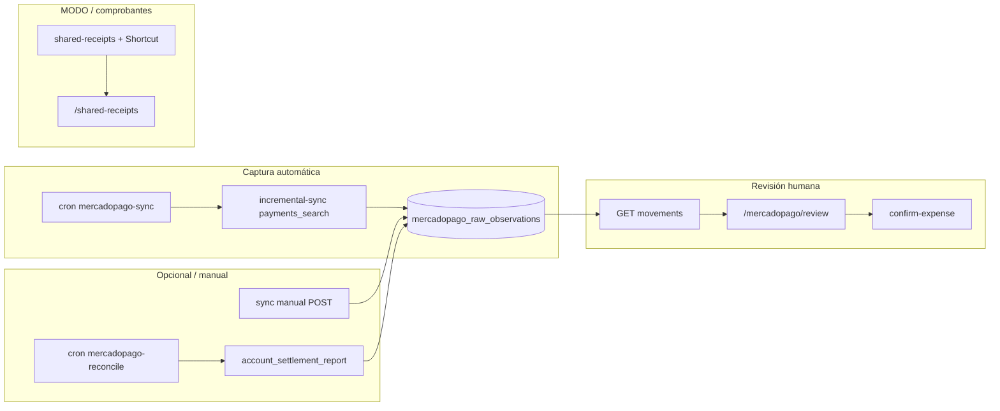

# Auditoría — Ingesta automática de movimientos (octubre 2026)

**Fecha:** 27/10/2026. **Solo lectura.** No se modificó `ROADMAP.md`, motor financiero, UI de producto ni esquema.

**Alcance:** Mercado Pago (`lib/mercadopago/*`, `app/(dashboard)/mercadopago`, APIs `app/api/integrations/mercadopago/*`, crons en `vercel.json` y `app/api/cron/*`), comprobantes compartidos / Shortcut (MODO), importación de extractos existente, deduplicación entre fuentes y revisión en mobile.

**Canon:** código en la rama auditada (`main` al abrir el PR). No se consultó producción, logs de Vercel ni cuentas reales de MP.

**Auditorías hermanas:** `docs/audits/g03-checkpoints.md` (conciliación de saldos, fuera de alcance), `docs/audits/g05-asesor.md` (asesor, fuera de alcance).

---

## Resumen (10 líneas)

1. La captura automática diaria (`/api/cron/mercadopago-sync`) persiste solo `payments_search` con rol `default`, sin `account_settlement_report` ni roles `payer`/`collector` del probe.
2. Muchos gastos confirmables en la bandeja exigen impacto en saldo observado vía settlement; la captura incremental no alimenta esa fuente.
3. La ventana incremental filtra por `date_created`; cambios de estado tardíos en pagos viejos no se reconsultan (alineado con MP-15 abierto).
4. Más de 500 pagos en un día de ventana marca error de proveedor y puede frenar el avance del watermark.
5. La reconstrucción de candidatos lee hasta 10 000 observaciones RAW; superar ese tope devuelve `movements_unavailable` (fail-closed, bandeja caída).
6. El cron de reconciliación/settlement existe pero no está programado en `vercel.json` y requiere `MERCADOPAGO_RECONCILIATION_ENABLED=true`.
7. El despacho diario reparte ~40 s entre conexiones (~1 ventana de un día por turno); el catch-up puede demorar días sin feedback en la bandeja de revisión.
8. La deduplicación MP↔manual es conservadora (solo saldo MP, `DEBIT`/`TRANSFER`); comprobantes MODO y compras con tarjeta MP no se cruzan con MP en el mismo motor (MODO-06 abierto).
9. “Extractos” en repo hoy es piloto BNA de rendimientos (`statement_imports`), no importación general de movimientos (G07 en Ideas).
10. Hay buena cobertura unitaria en `lib/mercadopago/*` y E2E de comprobantes; no hay E2E de revisión MP ni tests de dedupe entre las cuatro fuentes del ROADMAP.

---

## Tabla de hallazgos

| ID | Sev. | Hallazgo | Evidencia | Impacto usuario | ROADMAP |
|---|---|---|---|---|---|
| ING-01 | P0 | La captura incremental y el cron diario solo llaman `pullPayments` con rol `default`; los roles `payer`/`collector` existen solo en el probe de preview. | `lib/mercadopago/incremental-sync.ts:39`; `lib/mercadopago/observability-sync.ts:61`; `lib/mercadopago/capture-probe.ts:112-117` | Pagos visibles en MP pero asociados al rol incorrecto en search pueden no entrar a Gota. | **MP-14** (brecha abierta; este hallazgo la acota en código). |
| ING-02 | P0 | La captura automática no sincroniza `account_settlement_report`; el sync manual sí (pagos + settlement). | `lib/mercadopago/incremental-sync.ts:30-39`; `lib/mercadopago/observability-sync.ts:92-95` | Gastos con saldo MP suelen quedar sin `balanceImpact.observed` y no son confirmables aunque el pago exista en search. | **MP-14** (abierta). |
| ING-03 | P0 | Pagos no `approved` quedan con `status_not_consumed`; no hay re-sync por `date_last_updated` / id. | `lib/mercadopago/observability-sync.ts:24-28`; `lib/mercadopago/provider-movement.ts:123-132` | Devoluciones, contracargos y anulaciones tardías no actualizan la bandeja ni pasan a flujo de devolución. | **MP-15** (abierta; sin cambio). |
| ING-04 | P1 | Tope duro de paginación: 10 páginas × 50 ítems; si hay más, la corrida es `error` y no avanza watermark en incremental. | `lib/mercadopago/observability-sync.ts:11-12,61-82`; `lib/mercadopago/incremental-sync.ts:46` | Días muy movidos: captura incompleta, cursor trabado, movimientos ausentes hasta intervención. | Nueva (relacionada MP-14). |
| ING-05 | P1 | Más de 10 000 filas RAW por conexión hace fallar la lectura (`movement_observations_limit_exceeded` → HTTP 500 en movimientos). | `lib/mercadopago/server-repository.ts:98-115`; `app/api/integrations/mercadopago/movements/route.ts:18,45` | La bandeja “no carga”; el usuario no ve pendientes ni sabe que es por volumen. | Nueva. |
| ING-06 | P1 | El cron de reconciliación (settlement cerrado, shadow, auto-post) no está en `vercel.json`; además exige flag de entorno. | `vercel.json:1-11`; `app/api/cron/mercadopago-reconcile/route.ts:14-15` | Sin settlement programado, verificación de saldo y política `wait_for_reconciliation` persisten más tiempo. | Nueva (complementa MP-14/15; PR 145 mencionó acceso al cron). |
| ING-07 | P1 | Despacho diario: presupuesto compartido 40 s, `maxWindows: 1` por conexión por ejecución. | `lib/mercadopago/capture-dispatch.ts:57-59,89-91`; `lib/mercadopago/background-capture.ts:7-8` | Tras import inicial largo, el usuario ve “running” en setup pero la bandeja se llena lento; riesgo de cola si hay muchas conexiones. | **MP-18** (operacional); **MP-16** listo en código. |
| ING-08 | P1 | Dedupe MP↔manual: solo `funding === 'mp_balance'` y métodos `DEBIT`/`TRANSFER`; falla cerrado si la lectura no es exacta. | `lib/mercadopago/ledger-matcher.ts:33-49`; `lib/mercadopago/ledger-matcher-repository.ts:19-23`; `lib/mercadopago/posting-decision.ts:39-40` | Comprobante MODO o gasto con tarjeta no se ofrecen como duplicado de MP; riesgo de doble registro manual. | **MODO-06** (abierta). |
| ING-09 | P1 | Comprobantes: duplicados vía `/api/expenses/duplicates` (mismo día UTC, monto exacto); sin enlace a candidatos MP. | `app/api/expenses/duplicates/route.ts:20-36`; `lib/shared-receipts/bulk-review.ts:286-299` | Mismo consumo capturado por MP y por MODO requiere que el usuario lo note sin candidato cruzado. | **MODO-06** (abierta). |
| ING-10 | P2 | Compras MP con tarjeta de débito quedan en `cardPending` sin camino `confirmable` (solo crédito). | `lib/mercadopago/review.ts:69-76`; `lib/mercadopago/card-matcher.ts` (usado en UI); `lib/mercadopago/card-confirmation.test.ts:17` | Fricción: movimiento visible pero mensaje “por verificar” sin acción de registro clara. | Nueva (cobertura MP-14). |
| ING-11 | P2 | La página de revisión MP no muestra estado de captura (`lastUpdateAt`, error de sync); solo configuración/onboarding. | `components/mercadopago/MercadoPagoReviewClient.tsx:468-506`; `app/api/integrations/mercadopago/setup/route.ts:39-41` | En celular el usuario no distingue “no hay nada” de “todavía no llegó” o “falló la actualización”. | Nueva (relacionada MP-18). |
| ING-12 | P2 | Deuda de pruebas E2E: comprobantes sí (`e2e/receipts/*`); no hay spec Playwright para `/mercadopago/review` ni matriz cuatro fuentes. | `e2e/receipts/batch.spec.ts` (existe); búsqueda sin `e2e/**/*mercadopago*` | Regresiones de bandeja mobile y dedupe cruzado dependen de unit tests y diseño en exploración. | **MODO-05** (métricas); **MODO-06** (tests). |

**Notas de cobertura ROADMAP ya satisfecha en código (no son hallazgos nuevos):** captura diaria hacia revisión manual sin auto-post por defecto (`app/api/cron/mercadopago-sync/route.ts:9-10`); confirmación humana y lote hasta 20 (`lib/mercadopago/batch-review.ts:14`); política fail-closed de posting (`lib/mercadopago/posting-decision.ts:18-46`); campana con conteo por buckets (`components/signals/SignalsNowView.tsx:109-114`); **MP-19** / **MODO-07** en Listo del ROADMAP.

---

## Ítems propuestos (nuevos o refinamiento; máx. impacto primero)

### ING-01 — Activar estrategia de roles en captura productiva
**Por qué:** El probe demuestra tres roles; la captura real usa solo `default`.  
**Listo cuando:** (1) La captura incremental invoca la misma matriz de roles que el probe o documenta por qué `default` es suficiente con tests de fixtures. (2) No se duplican observaciones RAW al fusionar roles. (3) Métrica de conteo por rol en `mercadopago_sync_source_runs`.  
**Tamaño:** M · **Toca:** lógica financiera (identidad de movimientos), datos RAW.

### ING-02 — Settlement en el camino de captura automática
**Por qué:** La revisión de gastos con saldo MP depende del reporte de cuenta.  
**Listo cuando:** (1) Tras import inicial, al menos una fuente alimenta `balanceImpact.observed` sin sync manual. (2) Tests de integración: pago search + línea settlement → candidato confirmable. (3) Fallo de settlement no borra pagos ya capturados.  
**Tamaño:** L · **Toca:** datos + lógica de reconciliación MP (no ledger hasta confirmación).

### ING-03 — Reconciliación de cambios de estado tardíos
**Por qué:** Solo `date_created` no actualiza devoluciones en pagos antiguos.  
**Listo cuando:** (1) Diseño escrito (re-pull por id, ventana de `last_modified`, o job de estado). (2) Tests con pago aprobado luego `refunded`. (3) UI muestra bucket “devolución” coherente con `review-presentation.ts:8-9`.  
**Tamaño:** L · **Toca:** lógica financiera (clasificación), datos.

### ING-04 — Paginación y watermark sin falsos errores
**Por qué:** >500 pagos/día marca error y puede trabar el cursor.  
**Listo cuando:** (1) Comportamiento definido si `total > page cap` (seguir paginando o ventana más chica). (2) Test con paging mock >500. (3) `mercadopago_sync_source_runs` distingue “parcial con más páginas” de `provider_error`.  
**Tamaño:** M · **Toca:** datos (watermark), sin posting.

### ING-05 — Bandeja estable con alto volumen RAW
**Por qué:** >10 000 observaciones tumba el GET de movimientos.  
**Listo cuando:** (1) La API lista candidatos pendientes con cursor/paginación sin cargar todo el RAW. (2) Usuario con fixture >10 000 ve bandeja paginada, no 500. (3) Test de regresión en `server-repository`.  
**Tamaño:** L · **Toca:** datos (lectura), UI (paginación).

### ING-06 — Programar reconciliación settlement + política de flags
**Por qué:** El endpoint existe pero no corre en scheduler por defecto.  
**Listo cuando:** (1) Entrada en `vercel.json` o documentación explícita de cron externo acordado. (2) Runbook: flags `MERCADOPAGO_BACKGROUND_SYNC_ENABLED` y `MERCADOPAGO_RECONCILIATION_ENABLED`. (3) Al menos un test del route con flag on/off.  
**Tamaño:** S · **Toca:** infra; shadow/auto-post solo si flags lo habilitan.

### ING-07 — Feedback de catch-up en revisión MP
**Por qué:** Setup muestra `lastUpdateAt`; la bandeja no.  
**Listo cuando:** (1) `/mercadopago/review` muestra última captura exitosa o “sincronizando…”. (2) Si `initial_import.status === 'running'`, CTA coherente con setup. (3) Test de componente o contrato API.  
**Tamaño:** S · **Toca:** UI solamente.

### ING-08 — Dedupe cuatro fuentes (candidatos, sin fusión)
**Por qué:** MP, MODO, manual y extracto no comparten un índice de candidatos.  
**Listo cuando:** (1) Confirmar MP consulta posibles duplicados de origen comprobante cuando monto/fecha/merchant compatibles. (2) Confirmar comprobante sugiere MP pendiente con misma señal. (3) Tests cruzados; nunca auto-link.  
**Tamaño:** L · **Toca:** lógica financiera (idempotencia), datos.

### ING-09 — Tarjeta de débito en MP
**Por qué:** Quedan en bandeja sin flujo confirmable.  
**Listo cuando:** (1) Reglas explícitas para `cardType === 'debit'` (gasto vs compromiso de tarjeta). (2) UI con acción clara o descarte guiado. (3) Tests en `review.ts` / confirm route.  
**Tamaño:** M · **Toca:** lógica financiera al confirmar.

### ING-10 — E2E revisión MP en mobile
**Por qué:** No hay cobertura Playwright del flujo principal de ingesta MP.  
**Listo cuando:** (1) Spec que abre bandeja, confirma un gasto elegible mock, descarta otro. (2) Corre en CI. (3) Duplicado manual muestra pantalla de comparación.  
**Tamaño:** M · **Toca:** tests solamente.

*(ING-11 extractos generales queda acotado al ítem **G07** del ROADMAP; no se propone duplicar aquí.)*

---

## Flujo de ingesta (referencia)

---

## Extractos bancarios

| Pieza | Estado |
|---|---|
| Tablas `statement_imports` / `statement_import_rows` | Usadas por `app/api/yield-import/bna/route.ts` (rendimientos BNA, no movimientos generales). |
| UI de importación de extractos para gastos | No encontrada en `app/(dashboard)` alineada a G07. |
| ROADMAP **G07** | Idea P2; criterios de preview/duplicados/idempotencia aún no implementados para un banco piloto. |

---

## Reglas transversales observadas

| Regla | Cómo se ve en ingesta |
|---|---|
| Fail-closed | Dedupe no disponible bloquea auto-post (`posting-decision.ts:39`; `auto-post-service.test.ts`); movimientos no cargan si exceden límite RAW. |
| ARS/USD explícitos | Confirmación exige moneda en lista (`review.ts:46,57,74`). |
| Sin fusión automática | `ledger-matcher.ts:33`; duplicados MP son revisión (`attention: possible_duplicate`). |
| Idempotencia | Snapshots en confirm/dismiss/bulk (`confirm-expense` fingerprint; `bulk-dismiss/route.ts:9-17`). |

---

## Deuda de tests (resumen)

| Área | Cobertura | Hueco |
|---|---|---|
| MP sync/capture/reconcile | Amplia en `lib/mercadopago/*.test.ts` | Integración real con API MP (MP-14/18 operacional). |
| MP UI revisión | `lib/mercadopago-review-ui-contract.test.ts`, exploración UI | Sin E2E Playwright dedicado. |
| Comprobantes MODO | `e2e/receipts/*`, muchos unit en `lib/shared-receipts` | Métricas de lote (MODO-05). |
| Dedupe 4 fuentes | Unit por fuente | Sin suite cruzada MP+MODO+manual+extracto (MODO-06). |
